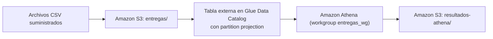

# Entregas de mensajería: S3 + Glue (partition projection) + Athena con Terraform

Examen final de Ingeniería de Datos (Universidad EIA, 2026-2), punto 1.
Autor: Juan José Jaramillo Mora.

Una empresa de mensajería recibe un CSV diario con los intentos de entrega de paquetes. Los archivos quedan en S3 y se consultan con Athena a través de una tabla externa de Glue Data Catalog con **partition projection por fecha**. Así, para incorporar un día nuevo basta con subir el archivo y consultar: no hay que correr crawlers, `MSCK REPAIR TABLE` ni `ALTER TABLE ADD PARTITION`.



## Estructura del repositorio

```text
.
├── README.md
├── .gitignore
├── respuestas.md                     # Respuestas a las preguntas conceptuales
├── infraestructura/
│   ├── principal.tf                  # Proveedor, bucket, bloqueo público, base, tabla con proyección y workgroup
│   ├── variables.tf                  # Región, nombres y rango de fechas proyectado
│   ├── salidas.tf                    # Outputs que identifican los recursos
│   └── .terraform.lock.hcl           # Versión fijada del proveedor AWS
├── consultas/
│   ├── intentos_por_fecha_estado.sql
│   ├── porcentaje_exito_por_fecha_ciudad.sql
│   ├── duracion_promedio_2026-10-02.sql
│   └── verificacion_tercer_dia.sql   # 3 sentencias: registros del día 3, conteos por estado y total
├── resultados/
│   ├── inicial/                      # Días 1 y 2
│   └── final/                        # Días 1, 2 y 3
├── evidencias/
│   ├── aplicacion_terraform.txt
│   ├── outputs.json
│   ├── ejecuciones_athena.csv
│   └── eliminacion_terraform.txt
├── scripts/
│   └── ejecutar_consulta.sh          # Ejecuta una consulta en Athena, guarda el CSV y registra la ejecución
├── data/entregas/                    # CSV suministrados (sin modificar)
└── resultados_esperados/             # Referencias suministradas
```

## Prerrequisitos

| Herramienta | Versión usada |
| --- | --- |
| Terraform | 1.14.8 (proveedor `hashicorp/aws` 5.100.0) |
| AWS CLI | 2.36.47 |
| Sistema | Ubuntu en WSL2 (Windows 11) |
| Región AWS | `us-east-1` |

Se necesita un perfil de AWS CLI con permisos sobre S3, Glue y Athena. Las credenciales **no** se escriben en el código: Terraform y la CLI las toman del perfil activo.

```bash
export AWS_PROFILE=admin        # perfil local con permisos; ajustar al propio
export AWS_REGION=us-east-1
aws sts get-caller-identity
```

## Recursos creados con Terraform

| Recurso | Nombre | Detalle |
| --- | --- | --- |
| Bucket S3 privado | `de-final-entregas-juanjo1414` | Block Public Access activo en las 4 opciones; `force_destroy` para la limpieza |
| Prefijo de datos | `entregas/` | `entregas/fecha=<yyyy-MM-dd>/entregas.csv` |
| Prefijo de resultados | `resultados-athena/` | Ubicación de salida del workgroup |
| Base de Glue | `entregas_db` | |
| Tabla externa | `entregas_db.entregas` | 5 columnas del CSV + partición `fecha` (string) |
| Workgroup de Athena | `entregas_wg` | Resultados en `resultados-athena/`, configuración forzada (`enforce_workgroup_configuration`) |

Los prefijos son parte de las claves de los objetos y no requieren directorios físicos: `entregas/` aparece al subir los CSV y `resultados-athena/` al ejecutar la primera consulta.

### Esquema de la tabla

| Columna | Tipo | Origen |
| --- | --- | --- |
| `id_envio` | `string` | CSV |
| `ciudad` | `string` | CSV |
| `transportadora` | `string` | CSV |
| `estado` | `string` | CSV |
| `duracion_minutos` | `int` | CSV |
| `fecha` | `string` | Clave de partición, tomada de la carpeta `fecha=yyyy-MM-dd` |

### Propiedades de la tabla

| Propiedad | Valor | Para qué |
| --- | --- | --- |
| SerDe | `LazySimpleSerDe`, `field.delim = ","` | Lee el CSV separado por coma |
| `skip.header.line.count` | `1` | Omite el encabezado de cada archivo |
| `projection.enabled` | `true` | Activa partition projection |
| `projection.fecha.type` | `date` | La partición se proyecta como fecha |
| `projection.fecha.format` | `yyyy-MM-dd` | Formato de la fecha en la ruta |
| `projection.fecha.range` | `2026-10-01,2026-10-03` | Rango proyectado, ambos extremos incluidos, desde el despliegue inicial |
| `projection.fecha.interval` / `.interval.unit` | `1` / `DAYS` | Un paso por día |
| `storage.location.template` | `s3://de-final-entregas-juanjo1414/entregas/fecha=${fecha}/` | Prefijo de cada partición, terminado en `/` |

En `principal.tf` la plantilla se escribe con `$${fecha}`. El doble `$` evita que Terraform intente interpolarla, así que a Glue llega el marcador literal `${fecha}`, que Athena reemplaza por cada fecha proyectada.

## 1. Despliegue

```bash
cd infraestructura
terraform init
terraform fmt
terraform validate
terraform plan
terraform apply -auto-approve -no-color | tee ../evidencias/aplicacion_terraform.txt
terraform output -json > ../evidencias/outputs.json
cd ..
```

Resultado: `Apply complete! Resources: 5 added, 0 changed, 0 destroyed.` (ver `evidencias/aplicacion_terraform.txt` y `evidencias/outputs.json`).

Verificación de la tabla en el catálogo:

```bash
aws glue get-table --database-name entregas_db --name entregas --query "Table.Parameters"
```

Antes de cargar archivos, `SELECT COUNT(*) FROM entregas_db.entregas` en el workgroup `entregas_wg` devolvió **0**.

> En la consola de Athena hay que seleccionar el workgroup `entregas_wg`. El workgroup por defecto (`primary`) no tiene ubicación de resultados configurada y no deja ejecutar consultas.

## 2. Demostración inicial: días 1 y 2

Se cargaron **solo** los dos primeros archivos, uno por uno, sin carga recursiva:

```bash
aws s3 cp "data/entregas/fecha=2026-10-01/entregas.csv" "s3://de-final-entregas-juanjo1414/entregas/fecha=2026-10-01/entregas.csv"
aws s3 cp "data/entregas/fecha=2026-10-02/entregas.csv" "s3://de-final-entregas-juanjo1414/entregas/fecha=2026-10-02/entregas.csv"
aws s3 ls s3://de-final-entregas-juanjo1414/entregas/ --recursive
```

Las consultas se ejecutan con `scripts/ejecutar_consulta.sh`. El script toma la sentencia indicada del archivo SQL y la lanza en el workgroup `entregas_wg` con `aws athena start-query-execution`. Espera a que termine y descarga el CSV que Athena escribió en `resultados-athena/`, quitando las comillas que Athena agrega a cada valor (ningún valor contiene comas). Por último, agrega una fila a `evidencias/ejecuciones_athena.csv`.

```bash
# Uso: bash scripts/ejecutar_consulta.sh <etapa> <archivo_sql> <archivo_resultado> [numero_de_sentencia]
bash scripts/ejecutar_consulta.sh inicial consultas/intentos_por_fecha_estado.sql resultados/inicial/intentos_por_fecha_estado.csv
bash scripts/ejecutar_consulta.sh inicial consultas/porcentaje_exito_por_fecha_ciudad.sql resultados/inicial/porcentaje_exito_por_fecha_ciudad.csv
bash scripts/ejecutar_consulta.sh inicial consultas/duracion_promedio_2026-10-02.sql resultados/inicial/duracion_promedio_2026-10-02.csv
```

Comparación con las referencias (sin diferencias en los tres casos):

```bash
diff resultados/inicial/intentos_por_fecha_estado.csv resultados_esperados/intentos_por_fecha_estado_inicial.csv
diff resultados/inicial/porcentaje_exito_por_fecha_ciudad.csv resultados_esperados/porcentaje_exito_por_fecha_ciudad_inicial.csv
diff resultados/inicial/duracion_promedio_2026-10-02.csv resultados_esperados/duracion_promedio_2026-10-02.csv
```

En esta etapa la tabla tiene **12 registros**. El 2026-10-03 ya está dentro del rango proyectado, pero no aparece en los resultados porque su prefijo todavía no tiene objetos en S3.

### Decisiones en las consultas

- **Intentos:** `COUNT(*)` agrupado por `fecha` y `estado`, ordenado de forma ascendente.
- **Porcentaje de éxito:** `100.0 * SUM(CASE WHEN estado = 'entregado' THEN 1 ELSE 0 END) / COUNT(*)`. El literal `100.0` evita la división entera, y el denominador incluye todos los estados. El resultado se redondea y se convierte a `DECIMAL(5,2)` para que siempre salga con dos decimales.
- **Duración promedio:** `AVG` solo sobre `estado = 'entregado'` del 2026-10-02, para no contar los ceros de los intentos fallidos. Las duraciones 25, 35 y 50 dan **36.67** minutos.
- **Sin filtro de fechas** en las consultas agregadas: la misma consulta sirve para ambas etapas e incluye el día 3 sin cambiar el SQL.

## 3. Incorporación del día 3

Sin modificar Terraform ni la tabla, se subió el tercer archivo y se consultó:

```bash
aws s3 cp "data/entregas/fecha=2026-10-03/entregas.csv" "s3://de-final-entregas-juanjo1414/entregas/fecha=2026-10-03/entregas.csv"

bash scripts/ejecutar_consulta.sh final consultas/verificacion_tercer_dia.sql resultados/final/verificacion_tercer_dia.csv 1
bash scripts/ejecutar_consulta.sh final consultas/verificacion_tercer_dia.sql resultados/final/conteos_estado_tercer_dia.csv 2
bash scripts/ejecutar_consulta.sh final consultas/verificacion_tercer_dia.sql resultados/final/total_registros.csv 3
bash scripts/ejecutar_consulta.sh final consultas/intentos_por_fecha_estado.sql resultados/final/intentos_por_fecha_estado.csv
bash scripts/ejecutar_consulta.sh final consultas/porcentaje_exito_por_fecha_ciudad.sql resultados/final/porcentaje_exito_por_fecha_ciudad.csv

diff resultados/final/intentos_por_fecha_estado.csv resultados_esperados/intentos_por_fecha_estado_final.csv
diff resultados/final/porcentaje_exito_por_fecha_ciudad.csv resultados_esperados/porcentaje_exito_por_fecha_ciudad_final.csv
```

`verificacion_tercer_dia.sql` contiene tres sentencias. El script ejecuta cada una por separado según el número indicado:

| Sentencia | Qué verifica | Resultado | Archivo |
| --- | --- | --- | --- |
| 1 | Registros del 2026-10-03 | 6 registros: de ENV-013 a ENV-018 | `resultados/final/verificacion_tercer_dia.csv` |
| 2 | Conteos por estado del 2026-10-03 | 3 `destinatario_ausente`, 1 `direccion_incorrecta`, 2 `entregado` | `resultados/final/conteos_estado_tercer_dia.csv` |
| 3 | Total de la tabla | 18 registros en 3 fechas | `resultados/final/total_registros.csv` |

Durante esta etapa **no** se ejecutaron crawlers, `MSCK REPAIR TABLE` ni `ALTER TABLE ADD PARTITION`, no se crearon particiones con Terraform y no se modificó ninguna propiedad de la tabla.

## 4. Resultados

| Consulta | Inicial (días 1 y 2) | Final (días 1 a 3) |
| --- | --- | --- |
| Intentos por fecha y estado | 6 filas, idéntico a la referencia | 9 filas, idéntico a la referencia |
| Porcentaje de éxito por fecha y ciudad | 4 filas, idéntico a la referencia | 6 filas, idéntico a la referencia |
| Duración promedio 2026-10-02 | 36.67 minutos, idéntico a la referencia | No cambia (sigue siendo el día 2) |
| Total de registros | 12 | 18 |

Ejecuciones registradas en `evidencias/ejecuciones_athena.csv`:

| Etapa | Consulta | ID de ejecución | Resultado |
| --- | --- | --- | --- |
| inicial | `intentos_por_fecha_estado.sql` | `54738b16-f54b-4392-bf18-88704261c77b` | `resultados/inicial/intentos_por_fecha_estado.csv` |
| inicial | `porcentaje_exito_por_fecha_ciudad.sql` | `b4c758b5-3cb6-412e-9a88-fa9b69c9bb57` | `resultados/inicial/porcentaje_exito_por_fecha_ciudad.csv` |
| inicial | `duracion_promedio_2026-10-02.sql` | `7717ee89-0a71-4406-a719-36e2e979608b` | `resultados/inicial/duracion_promedio_2026-10-02.csv` |
| final | `verificacion_tercer_dia.sql` (registros) | `343f0e9c-c081-4a50-bab0-494ac27db93a` | `resultados/final/verificacion_tercer_dia.csv` |
| final | `verificacion_tercer_dia.sql` (conteos por estado) | `9faf8d19-4e7b-4fe0-9a6a-30d4f76b6749` | `resultados/final/conteos_estado_tercer_dia.csv` |
| final | `verificacion_tercer_dia.sql` (total) | `88aeece6-8995-4a77-9553-22bf0449f0cb` | `resultados/final/total_registros.csv` |
| final | `intentos_por_fecha_estado.sql` | `e13492a5-644b-4088-b5a3-98c3d8501133` | `resultados/final/intentos_por_fecha_estado.csv` |
| final | `porcentaje_exito_por_fecha_ciudad.sql` | `93d72125-a6cc-4a47-b382-1660b342fed6` | `resultados/final/porcentaje_exito_por_fecha_ciudad.csv` |

## 5. Preguntas conceptuales

Las respuestas están en [`respuestas.md`](respuestas.md).

## 6. Limpieza

Primero se guardaron y versionaron todas las evidencias. Después se eliminaron los recursos con Terraform. El bucket y el workgroup tienen `force_destroy = true`, así que Terraform vacía los objetos (los CSV de `entregas/` y los resultados de `resultados-athena/`) y el historial del workgroup antes de borrarlos.

```bash
cd infraestructura
terraform destroy -auto-approve -no-color | tee ../evidencias/eliminacion_terraform.txt
cd ..
```

Verificación de que no quedaron recursos:

```bash
aws s3api head-bucket --bucket de-final-entregas-juanjo1414          # 404 Not Found
aws glue get-database --name entregas_db                              # EntityNotFoundException
aws athena get-work-group --work-group entregas_wg                    # InvalidRequestException
```

La evidencia de eliminación está en `evidencias/eliminacion_terraform.txt`.

## Seguridad

- Bucket privado, con Block Public Access en sus cuatro opciones.
- Sin credenciales en el repositorio: Terraform y la CLI usan el perfil local de AWS CLI (`AWS_PROFILE`).
- El `.gitignore` excluye `.terraform/`, `*.tfstate`, `*.tfvars`, llaves, archivos de credenciales y `.env`.
- El workgroup fuerza su configuración, de modo que todos los resultados quedan en el prefijo `resultados-athena/` del mismo bucket.