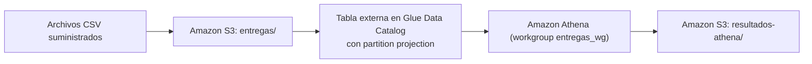

# Entregas de mensajería: S3 + Glue (partition projection) + Athena con Terraform

Examen final de Ingeniería de Datos (Universidad EIA, 2026-2), punto 1.
Autor: Juan José Jaramillo Mora.

Una empresa de mensajería recibe un CSV diario con los intentos de entrega. Los archivos quedan en S3 y se consultan con Athena a través de una tabla externa de Glue Data Catalog con **partition projection por fecha**, de modo que un día nuevo solo requiere subir el archivo y consultar: sin crawlers, sin `MSCK REPAIR TABLE` y sin `ALTER TABLE ADD PARTITION`.



## Estructura del repositorio

```text
.
├── README.md
├── .gitignore
├── respuestas.md
├── infraestructura/          # Terraform: bucket, base, tabla con proyección, workgroup, outputs
├── consultas/                # SQL de Athena
├── resultados/inicial/       # Resultados con los días 1 y 2
├── resultados/final/         # Resultados con los días 1, 2 y 3
├── evidencias/               # apply, outputs, ejecuciones de Athena y destroy
├── scripts/ejecutar_consulta.sh  # Ejecuta una consulta en Athena y registra la ejecución
├── data/entregas/            # CSV suministrados (sin modificar)
└── resultados_esperados/     # Referencias suministradas
```

## Prerrequisitos

- Terraform >= 1.5 y AWS CLI v2, ejecutados desde Ubuntu (WSL2).
- Un perfil de AWS CLI con permisos sobre S3, Glue y Athena. Las credenciales nunca se escriben en el código: Terraform y la CLI las toman del perfil activo.
- Región: `us-east-1`.

```bash
export AWS_PROFILE=admin        # perfil local con permisos (ajustar al propio)
export AWS_REGION=us-east-1
aws sts get-caller-identity
```

## Recursos creados con Terraform

| Recurso | Nombre | Detalle |
| --- | --- | --- |
| Bucket S3 privado | `de-final-entregas-juanjo1414` | Bloqueo de acceso público en sus cuatro opciones |
| Prefijo de datos | `entregas/` | `entregas/fecha=<yyyy-MM-dd>/entregas.csv` |
| Prefijo de resultados | `resultados-athena/` | Salida del workgroup |
| Base de Glue | `entregas_db` | |
| Tabla externa | `entregas_db.entregas` | 5 columnas + partición `fecha` (string) |
| Workgroup de Athena | `entregas_wg` | Resultados en `resultados-athena/`, configuración forzada |

Propiedades de la tabla:

| Propiedad | Valor | Para qué |
| --- | --- | --- |
| `skip.header.line.count` | `1` | Omite el encabezado de cada CSV |
| SerDe `LazySimpleSerDe`, `field.delim` | `,` | Lee el CSV separado por coma |
| `projection.enabled` | `true` | Activa partition projection |
| `projection.fecha.type` | `date` | La partición se proyecta como fecha |
| `projection.fecha.format` | `yyyy-MM-dd` | Formato de la fecha en la ruta |
| `projection.fecha.range` | `2026-10-01,2026-10-03` | Rango proyectado, ambos extremos incluidos |
| `projection.fecha.interval` / `.interval.unit` | `1` / `DAYS` | Un paso por día |
| `storage.location.template` | `s3://<bucket>/entregas/fecha=${fecha}/` | Prefijo de cada partición, terminado en `/` |

## 1. Despliegue

```bash
cd infraestructura
terraform init
terraform fmt
terraform validate
terraform plan
terraform apply -auto-approve -no-color | tee ../evidencias/aplicacion_terraform.txt
terraform output -json > ../evidencias/outputs.json
cd ..
export BUCKET=$(terraform -chdir=infraestructura output -raw bucket)
```

## 2. Demostración inicial: días 1 y 2

Se cargan **solo** los dos primeros archivos, uno por uno (sin carga recursiva):

```bash
aws s3 cp "data/entregas/fecha=2026-10-01/entregas.csv" "s3://$BUCKET/entregas/fecha=2026-10-01/entregas.csv"
aws s3 cp "data/entregas/fecha=2026-10-02/entregas.csv" "s3://$BUCKET/entregas/fecha=2026-10-02/entregas.csv"
aws s3 ls "s3://$BUCKET/entregas/" --recursive
```

Se ejecutan las consultas. El script lanza cada consulta en el workgroup `entregas_wg`, espera a que termine, descarga el CSV de `resultados-athena/` y agrega una fila a `evidencias/ejecuciones_athena.csv`:

```bash
bash scripts/ejecutar_consulta.sh inicial consultas/intentos_por_fecha_estado.sql resultados/inicial/intentos_por_fecha_estado.csv
bash scripts/ejecutar_consulta.sh inicial consultas/porcentaje_exito_por_fecha_ciudad.sql resultados/inicial/porcentaje_exito_por_fecha_ciudad.csv
bash scripts/ejecutar_consulta.sh inicial consultas/duracion_promedio_2026-10-02.sql resultados/inicial/duracion_promedio_2026-10-02.csv
```

Comparación con las referencias (sin salida = idénticos):

```bash
diff resultados/inicial/intentos_por_fecha_estado.csv resultados_esperados/intentos_por_fecha_estado_inicial.csv
diff resultados/inicial/porcentaje_exito_por_fecha_ciudad.csv resultados_esperados/porcentaje_exito_por_fecha_ciudad_inicial.csv
diff resultados/inicial/duracion_promedio_2026-10-02.csv resultados_esperados/duracion_promedio_2026-10-02.csv
```

En esta etapa hay 12 registros. El 2026-10-03 ya está dentro del rango proyectado, pero no aparece en los resultados porque su prefijo todavía no tiene objetos en S3.

## 3. Incorporación del día 3

Sin tocar Terraform ni la tabla, se sube el tercer archivo y se consulta:

```bash
aws s3 cp "data/entregas/fecha=2026-10-03/entregas.csv" "s3://$BUCKET/entregas/fecha=2026-10-03/entregas.csv"

bash scripts/ejecutar_consulta.sh final consultas/verificacion_tercer_dia.sql resultados/final/verificacion_tercer_dia.csv 1
bash scripts/ejecutar_consulta.sh final consultas/verificacion_tercer_dia.sql resultados/final/conteos_estado_tercer_dia.csv 2
bash scripts/ejecutar_consulta.sh final consultas/verificacion_tercer_dia.sql resultados/final/total_registros.csv 3
bash scripts/ejecutar_consulta.sh final consultas/intentos_por_fecha_estado.sql resultados/final/intentos_por_fecha_estado.csv
bash scripts/ejecutar_consulta.sh final consultas/porcentaje_exito_por_fecha_ciudad.sql resultados/final/porcentaje_exito_por_fecha_ciudad.csv

diff resultados/final/intentos_por_fecha_estado.csv resultados_esperados/intentos_por_fecha_estado_final.csv
diff resultados/final/porcentaje_exito_por_fecha_ciudad.csv resultados_esperados/porcentaje_exito_por_fecha_ciudad_final.csv
```

`verificacion_tercer_dia.sql` tiene tres sentencias: los seis registros del 2026-10-03, sus conteos por estado (3 `destinatario_ausente`, 1 `direccion_incorrecta`, 2 `entregado`) y el total de la tabla (18 registros en 3 fechas). Las consultas de intentos y porcentaje no filtran fechas, así que incluyen el tercer día sin cambiar el SQL.

No se ejecutaron crawlers, `MSCK REPAIR TABLE` ni `ALTER TABLE ADD PARTITION`, y no se modificó ninguna propiedad de la tabla.

## 4. Resultados

| Consulta | Inicial (días 1 y 2) | Final (días 1 a 3) |
| --- | --- | --- |
| Intentos por fecha y estado | 6 filas, igual a la referencia | 9 filas, igual a la referencia |
| Porcentaje de éxito por fecha y ciudad | 4 filas, igual a la referencia | 6 filas, igual a la referencia |
| Duración promedio 2026-10-02 | 36.67 minutos (25, 35 y 50) | No cambia |

Los identificadores de cada ejecución están en `evidencias/ejecuciones_athena.csv`.

## 5. Limpieza

Primero se guardan todas las evidencias. Después se eliminan los recursos con Terraform. El bucket y el workgroup tienen `force_destroy = true`, por lo que Terraform vacía los objetos (datos y resultados de Athena) antes de borrarlos:

```bash
cd infraestructura
terraform destroy -auto-approve -no-color | tee ../evidencias/eliminacion_terraform.txt
cd ..
aws s3 ls "s3://$BUCKET" 2>&1 | tail -1   # debe responder NoSuchBucket
```

## Seguridad

- Bucket privado con Block Public Access.
- Sin credenciales en el repositorio: se usa el perfil local de AWS CLI.
- `.gitignore` excluye `.terraform/`, archivos `*.tfstate`, `*.tfvars`, llaves y credenciales.
